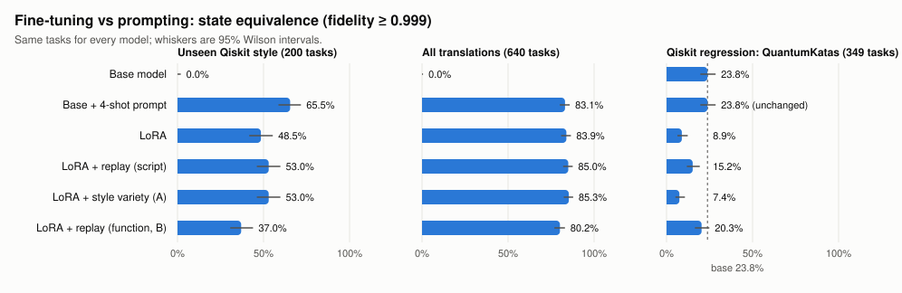

# qiskit-to-cudaq

**Fine-tuning an open model to translate Qiskit circuits into CUDA-Q kernels, measured by executing both programs and comparing quantum states.**

I fine-tuned [NVIDIA Nemotron 3 Nano 4B](https://huggingface.co/nvidia/NVIDIA-Nemotron-3-Nano-4B-BF16) with LoRA on a single NVIDIA L4 GPU. Evaluation does not compare text and does not use an LLM as a judge. Every generated kernel runs in an isolated process, and it counts as correct only if it prepares the same quantum state as the Qiskit reference (state fidelity ≥ 0.999).

Most of the work went into making the measurement trustworthy before training anything. The evaluator was itself tested, and a rule-based baseline showed that two of the three original test sets did not need a model at all.

## Results

Same 640 translation tasks and 349 QuantumKatas tasks for every model, same inference engine and settings. 95% Wilson intervals in brackets; p-values from an exact McNemar test on the tasks whose outcome changed.



| State equivalence (fidelity ≥ 0.999) | Rule-based translator | Base model | Base + 4-shot prompt | Fine-tuned (LoRA) |
|---|---:|---:|---:|---:|
| Larger circuits, 6–7 qubits (240) | 100% | 0% | 89.6% | **100%** [98.4–100] |
| Unseen circuit family (200) | 100% | 0% | 93.0% | **100%** [98.1–100] |
| Unseen Qiskit coding style (200) | 0% | 0% | **65.5%** [58.7–71.7] | 48.5% [41.7–55.4] |
| All translation tasks (640) | 68.8% | 0% | 83.1% [80.0–85.8] | 83.9% [80.9–86.5] |
| **Qiskit regression: QuantumKatas (349)** | | **23.8%** [19.6–28.5] | 23.8% (model unchanged) | 8.9% [6.3–12.3] |

What this shows:

- **The base model does not know CUDA-Q.** None of its 640 answers was a valid kernel. It wrote functions that contained only comments, or confused CUDA-Q with CUDA C (`__global__ void kernel()`).
- **On the training style, the fine-tuned model matches a ~70-line rule-based translator** (100% on larger circuits and on the unseen family). Those test sets are solvable by text substitution.
- **On an unseen coding style, the model generalizes partially (48.5%), where the rules score 0%.** The hardest idiom is `qc.append(RYGate(θ), [q])` (9.8%): the model invents gate names such as `r_y`, or copies Qiskit structure into CUDA-Q.
- **The cost in Qiskit is real: 23.8% → 8.9% on the QuantumKatas** (62 tasks lost, 10 gained; p = 3·10⁻¹⁰). The model did not forget Qiskit. It keeps the Qiskit function skeleton but writes CUDA-Q-style gate calls inside it (`r1.ctrl(q0, q1)` instead of `qc.cp(...)`): interference between the two syntaxes.
- **A 4-example prompt matches the fine-tuned model overall (83.1% vs 83.9%, p = 0.69).** LoRA is better on the training style (100% vs 90–93%), where a rule-based script also works. The prompt is better on the unseen style (65.5% vs 48.5%, p = 2·10⁻⁵), because the untouched base model keeps its broader Qiskit knowledge. It has no Qiskit regression, but adds about 1,370 tokens to every request (about 5× the zero-shot prompt: 1,712 vs 342 tokens on average). The four examples come from the training set and are fixed for all tasks.

**Practical consequence:** for this task, fine-tuning pays off mainly when request volume makes the extra prompt tokens expensive, or when inputs follow a predictable format. If you serve the adapter, use it only where it helps: vLLM serves several LoRA adapters on one base model, so translation requests can go to the adapter and everything else to the base model.

Training took 29 minutes on one L4 (peak 15.4 GB). The whole project used about 17 GPU-hours: four trainings, six evaluation runs and the tests.

## Mitigating the Qiskit regression

Three variants of the training data, each with the same LoRA configuration, validation set and inference engine. Nothing from the Katas or the test sets enters training.

| State equivalence | Base + 4-shot | LoRA | + replay, script | + style variety (A) | + replay, function (B) |
|---|---:|---:|---:|---:|---:|
| Training style (size 240 / family 200) | 89.6% / 93.0% | 100% / 100% | 100% / 99.0% | 100% / 100% | 100% / 99.5% |
| Unseen style (200) | **65.5%** | 48.5% | 53.0% | 53.0% | 37.0% |
| ↳ idioms seen in A's training (80) | 75.0% | 80.0% | 53.8% | **100%** | — |
| ↳ held-out idioms `append` / `funcao` (120) | **59.2%** | 27.5% | 52.5% | 21.7% | — |
| All translations (640) | 83.1% | 83.9% | 85.0% | 85.3% | 80.2% |
| **QuantumKatas (349)** (base 23.8%) | 23.8% | 8.9% | 15.2% | 7.4% | **20.3%** |

**Replay, script format.** 20% of training examples in the reverse direction (CUDA-Q → Qiskit), from training circuits. The Katas recover from 8.9% to 15.2% (27 gained, 5 lost; p = 1·10⁻⁴) at no cost to translation, but stay below the base model (p = 4·10⁻⁵). The syntax interference disappears: Katas answers containing CUDA-Q syntax go from 35% (LoRA) to 2%, and answers using `qc.<gate>(...)` from 6% to 70% (base: 0% and 78%). What remains is a format problem: of the 41 tasks the base model solved and this model fails, only 21 contain `return qc` (base: 41 of 41). The reverse examples are flat scripts with no function or `return`, and the model carried that format into the Katas. Gate-logic errors also appear, such as `qc.cz` where the base model wrote `qc.cx(control, target)`.

**(A) Style variety.** 30% of training pairs rewritten with 6 idioms (replacing the originals, so the training set keeps its size), holding out the `append` and helper-function (`funcao`) idioms for the test. Seen idioms reach 100%; held-out idioms stay at 21.7%. Fine-tuning learns the variations it is shown and does not become more robust to new ones. Only the untouched base model with a prompt does well on idioms nobody showed it (59.2%).

**(B) Replay, function format.** 339 Qiskit examples in the Katas' format ("complete the function and return the circuit"), with docstrings that describe the gates, built from training circuits and verified by execution. The Qiskit regression closes (20.3% vs 23.8% for the base model, p = 0.10), but translation of non-canonical inputs drops to 37.0%. Most failures copy Qiskit constructs into the kernel (`barrier()`, `measure_all()`: 44 of 127) or write Qiskit API calls (`qc.`: 31); a smaller group (8) uses raw integer indices (`rx(0.38, 0)`) without allocating `cudaq.qvector`, the index style of the replay data.

**Pattern across all variants:** auxiliary training data fixes the task it imitates and leaks its format into neighbouring tasks. Mitigation is a trade-off, and it has to be measured on both sides.

## Robustness checks and alternatives

Same 640 translations, 349 Katas, verifier and greedy decoding. Held-out idioms are the `append` and helper-function rewrites, absent from every training set.

| State equivalence | All (640) | Unseen style (200) | Held-out idioms (120) | QuantumKatas (349) |
|---|---:|---:|---:|---:|
| Nemotron 4B, LoRA seed 0 / 1 / 2 | 83.9 / 82.5 / 80.2% | 48.5 / 45.0 / 37.0% | 27.5 / 29.2 / 15.8% | 8.9 / 6.9 / 7.4% |
| Nemotron 4B, LoRA + style variety (A) | 85.3% | 53.0% | 21.7% | 7.4% |
| Nemotron 4B, LoRA seed 0 + GRPO (200 steps) | **86.9%** | 59.5% | 35.8% | 8.6% |
| Nemotron 4B, LoRA seed 0 + 1-shot / 2-shot prompt | 74.8 / 78.4% | 40.0 / 46.5% | 31.7 / 43.3% | — |
| Nemotron 4B, LoRA + mixed replay | 84.4% | 53.0% | 48.3% | 21.5% |
| Nemotron 4B, base, 4-shot | 83.1% | **65.5%** | **59.2%** | 23.8% |
| Qwen2.5-Coder 1.5B, base, 4-shot | 50.3% | 19.0% | 18.3% | 17.8% |
| Qwen2.5-Coder 1.5B, LoRA | 77.8% | 29.0% | 28.3% | 5.2% |
| Qwen2.5-Coder 7B, base, zero-shot | 0% | 0% | 0% | **30.9%** |
| Qwen2.5-Coder 7B, base, 4-shot | 82.8% | 65.0% | 54.2% | 30.9% |

- **Seeds.** Overall 82.2% ± 1.9 points; unseen style 43.5% ± 5.9. Generalization to new idioms depends on the seed, but the gap to the prompt is larger than the spread.
- **Second base model.** Qwen2.5-Coder 7B does not know CUDA-Q either (0% zero-shot) and, with the same four examples, ties Nemotron. It knows more Qiskit (30.9% on the Katas). These two runs used 8 concurrent requests, so their greedy outputs are not exactly reproducible.
- **Prompt sensitivity.** Two more 4-example sets of the same composition: 81.9% and 48.3%. The weak set has no `rx`/`ry`, and the model then scores 0% on the W family.
- **GEPA prompt optimization** (`eval/gepa_otimiza.py`). From zero-shot it never leaves a score of zero; from the weak example set it improves the validation score (0.73 → 0.89, graded) but not the test sets (43.6% vs 44.8%).
- **GRPO pilot** (`train/grpo_piloto.py`). Continues the seed-0 adapter with the verifier as reward (graded: 1 equivalent, 0.1 + 0.4·fidelity if it runs) on variant A's prompts, 200 steps, 2.5 h on one L4. It is the first weight update that improves held-out idioms (35.8% vs 21.7% for A; 24 gained, 2 lost on the unseen style vs its starting point, p < 10⁻⁴), with no further loss on the Katas. Still below the 4-shot prompt on new idioms, and the Qiskit regression stays.

- **Adapter plus examples.** One or two examples in the adapter's prompt: held-out idioms improve with two (27.5% → 43.3%, p = 0.001), but exactness on the training style is lost and the total falls (78.4%, p < 0.001).
- **Mixed replay** (half reverse scripts, half functions; same replay share): the best trade-off, 84.4% translation and 21.5% on the Katas (base 23.8%, p = 0.31).
- **Smaller second model with LoRA.** On Qwen2.5-Coder 1.5B, fine-tuning beats the 4-shot prompt (77.8% vs 50.3%), with the same Katas regression (17.8% → 5.2%). Served with vLLM 0.33.
- **Coverage fix.** The weak example set with its random example replaced by one using all 12 gates: 48.3% → 71.9%.
- **pass@5** on the 120 held-out-idiom tasks: adapter 28.3% → 37.5%, 4-shot 58.3% → 78.3%.
- **Fidelity threshold.** At 0.99 or 0.9999 no model changes by more than one task (`eval/limiar.py`).
- **Circuit-level converter** (`eval/linha_base_circuito.py`): executes the Qiskit input, transpiles the circuit to known gates and maps each instruction. **100% on all 640 tasks**, because every input is a static, executable circuit. The benchmark therefore measures source-level translation; a language model is only needed where execution is not available or not wanted.
- **Real code (QED-C).** 27 tasks built from the Qiskit kernels of six QED-C benchmarks (`generate/qedc.py`, Apache-2.0 sources in `data/qedc_fonte/`). **No model translates any of them** (4-shot, LoRA, GRPO, mixed replay); the circuit-level converter translates all 27.

Summary in `results/resumo_sementes_grpo.json`; failure categories for every model in `results/taxonomia_erros.json` (`eval/taxonomia.py`).

## Why this task

- **Verifiable by execution.** Two programs, two state vectors, one fidelity. This gives unlimited correct-by-construction data and an objective metric.
- **A real adoption cost.** Most public quantum code is written in Qiskit, and moving it to CUDA-Q means rewriting it.
- **The gap is where fine-tuning helps most.** Open models see a lot of Qiskit and very little CUDA-Q.

## How the evaluation works

What is checked, explicitly:

1. the answer contains Python code (the first fenced block that mentions `cudaq`, otherwise the first block);
2. the code defines a CUDA-Q kernel that takes no arguments;
3. the kernel compiles and runs;
4. its state has fidelity ≥ 0.999 with the Qiskit reference state (`|⟨ψ_a|ψ_b⟩|²`, which ignores global phase).

Before execution, the verifier removes `mz` calls and drops top-level statements that are not definitions (`print`, `cudaq.sample`). Without this, correct translations would fail for evaluator reasons (see calibration below). Valid-output rate and equivalence are reported separately, and environment failures are counted apart and retried once. Each candidate runs in its own subprocess (`python -I`, temporary directory) with no access to the reference, following the recommendations of Seefried et al.

### Calibration (CUDA-Q 0.16.0, `qpp-cpu`, Qiskit 2.6.1)

- **State vectors use the same qubit order** in both libraries (minimum fidelity 1.0 over 60 random circuits with all 12 gates, up to 7 qubits).
- **`sample` bitstrings use the opposite order** (`X` on qubit 0 gives `100` in CUDA-Q and `001` in Qiskit). Comparing counts naively would fail correct translations.
- **`mz` inside a kernel collapses the state returned by `get_state`.** A 4-qubit GHZ with `mz` returned `|0000⟩` or `|1111⟩`, never the superposition, so a correct candidate would fail at random.

### Testing the evaluator

- **Negative control:** I corrupted 600 correct translations (final phase, flipped angle, deleted gate, swapped control). Of the 503 mutants that actually change the state, fidelity rejected 500; the other 3 had fidelity up to 0.9997. **Measurement counts caught 0 of the 150 phase-only errors**, because probabilities do not change.
- **Fake models:** a perfect model scores 100%, garbage 0%, and "valid but wrong" scores 100% valid output with 0.2% equivalence.
- **Rule-based baseline:** a ~70-line translator scored 100% on the size and family tests, which motivated the style test.

### Regression probe

The [Qiskit QuantumKatas](https://github.com/qiskit-community/Qiskit-QuantumKatas) (350 tasks) were audited first: every canonical solution was run three times and every empty skeleton once. One test (`Teleportation/1.7`) passes the empty skeleton, because the skeleton already returns `True` and the test only checks the return value. It was excluded, leaving 349 tasks.

## Data

1,946 Qiskit/CUDA-Q pairs from six circuit families, generated by `generate/`. Each pair was executed on both sides and kept only if its fidelity was ≥ 0.999. Gate set: `h, x, y, z, s, t, rx, ry, rz, cx, cz, swap`, plus `cp`, `cry` and `mcx` in the QFT, W and Grover families.

| Split | Pairs | Content | Question |
|---|---:|---|---|
| Train / validation | 1,355 / 151 | random, GHZ, W, QFT, Grover; 2–5 qubits | |
| Size test | 240 | same families, 6–7 qubits | does it generalize in size? |
| Structure test | 200 | hardware-efficient ansatz, never seen | does it generalize in structure? |
| Style test | 200 | test circuits rewritten with common Qiskit idioms | does it generalize in coding style? |

The style test rewrites only the Qiskit side, using `QuantumRegister`, other circuit names, `h([0, 2])` / `h(range(n))`, `append(Gate(), [...])`, helper functions, `barrier()`, `measure_all()` and `np.pi`. Gates, sizes and the CUDA-Q reference stay the same, and every rewrite was executed and gives exactly the original state. Training data stays in the canonical style on purpose.

## Training

LoRA on `nvidia/NVIDIA-Nemotron-3-Nano-4B-BF16` (hybrid Mamba-2 + Transformer), in BF16, with Hugging Face TRL 0.22.2, PEFT and transformers 4.56.2.

| Setting | Value | Why |
|---|---|---|
| Rank / alpha | 32 / 64 | enough capacity for a narrow task |
| Target modules | attention (q, k, v, o) and MLP (up, down) | PEFT rejects LoRA on the Mamba `out_proj`/`conv1d` of this model, and vLLM does not map LoRA onto the fused Mamba `in_proj` |
| Effective batch | 16 | about 170 optimizer steps over 2 epochs |
| Learning rate | 1e-4, 5% warmup, cosine | common range for LoRA; not tuned |
| Loss | completion only | do not learn to repeat the prompt |
| Checkpoint | lowest validation loss (step 160 of 170) | selected without looking at the test sets |
| Reasoning mode | `enable_thinking=False` everywhere | the model reasons by default |

**Training data uses the chat format.** With plain-text prompt/completion fields, TRL 0.22.2 tokenizes without the chat template, so training and inference would see different tokens. `train/confere_tokens.py` runs TRL's own preprocessing on CPU and checks, for every example, that the training prefix is token-identical to what generation feeds the model, that only the answer is in the loss, and that the end-of-turn token is learned.

## Generation

Generation runs on vLLM 0.24 (the Red Hat AI build) on OpenShift AI, one L4, with LoRA adapters loaded at runtime (`k8s/vllm-nemotron.yaml`). The client tokenizes each prompt with the verified template and sends token ids to `/v1/completions`, so the model receives exactly the tokens checked in training. Greedy decoding, `max_tokens` 1024, stop on `<|im_end|>` (id 11) and `</s>` (id 2).

Two findings shaped this setup:

- **The Hugging Face `generate` path of this model has no working cache.** The hybrid cache is created but never reaches the forward pass, and the cache class has further defects, so every token recomputes the full sequence (about 60 s per task). vLLM implements Nemotron-H natively.
- **Greedy decoding is not reproducible under dynamic batching.** Running the same 40 tasks twice with 16 concurrent requests gave identical outputs for only 23 of them; with one request at a time, for 40 of 40. All evaluation runs therefore use one request at a time (about 10 s per task). With high concurrency, part of the before/after difference would be server noise.

## Limitations

- Up to 7 qubits, in simulation, with a fixed gate set. No mid-circuit measurement, no kernel arguments, no classical control flow.
- Calibration holds for the versions and target listed above.
- The 0.999 threshold lets very small differences through, as the negative control shows (3 of 503).
- The style test covers eight idioms chosen by the author; real code is more varied. The rules' 0% on it reflects a translator written for the canonical style.
- Training on one base model (a second one, Qwen2.5-Coder 7B, only prompted), one LoRA configuration, no hyperparameter search; three seeds show several points of spread on the unseen style. The validation set comes from the training distribution and only selects the checkpoint.
- Changing the inference engine changes exact outputs (3 tasks compared between transformers and vLLM: 1 identical, 2 diverged at some point with the same content), so both runs use the same engine.
- The few-shot baseline uses fixed sets of four examples; one of the three sets tested scored much lower.
- GEPA and GRPO were run once each, with small budgets.

## Next steps

1. Mix both replay formats (script and function) and check whether the two leaks cancel.
2. LoRA plus a short prompt, to combine the adapter's exactness with the base model's robustness.
3. Longer RL with the verifier as reward, without partial credit for code that runs but prepares the wrong state.
4. Larger circuits with mid-circuit measurement and kernel arguments.

## Reproducing

```bash
# Mac or Linux, CPU: corpus, verifier, evaluation (Python 3.12)
pip install -r requirements-mac.txt
python verify/calibrate.py                 # conventions between Qiskit and CUDA-Q
python generate/build.py                   # corpus (fixed seed)
python generate/estilo.py                  # style test
python verify/controle_negativo.py         # negative control
python eval/teste_falsos.py                # fake models
python eval/linha_base_regras.py           # rule-based baseline
python train/dados_sft.py                  # chat-format training data

# GPU workbench (1x L4): training
bash setup_workbench.sh                    # pinned versions, token check, smoke test
python train/lora.py                       # -> runs/lora/final

# vLLM on OpenShift: generation
oc apply -f k8s/vllm-nemotron.yaml
python eval/gerar_vllm.py --nome baseline
python eval/gerar_vllm.py --nome finetuned --modelo-servido qiskit2cudaq
python eval/gerar_vllm.py --nome fewshot --fewshot 4 --tipo traducao

# mitigation variants (data -> training -> generation as above, with --dados and the adapter name)
python generate/estilo_treino.py           # (A) style-varied training pairs
python generate/replay_funcao.py           # (B) function-format replay examples
python train/dados_sft.py                  # writes sft_treino_{replay,estilos,funcao}.jsonl
python train/lora.py --dados sft_treino_replay.jsonl --saida runs/lora_replay

# evaluation (CPU)
python eval/translate_eval.py data/saidas/finetuned.jsonl --resultado results/finetuned_traducao.json
python eval/regression.py --auditoria      # once; executes third-party code
python eval/regression.py --saidas data/saidas/finetuned.jsonl --resultado results/finetuned_katas.json
python eval/compara.py                     # paired comparison: base vs LoRA
python eval/compara.py fewshot finetuned   # any two models
```

The QuantumKatas data is not redistributed (CC-BY-NC-SA-4.0). Download it from Hugging Face (`Qiskit/Qiskit-QuantumKatas`) into `data/katas/qiskit_quantumkatas.jsonl`; `data/katas.sha256` holds the hash of the version used. Code comments and some script names are in Portuguese.

## Repository layout

```
generate/   corpus families, corpus build, style test, mitigation data
verify/     isolated runner, sanitizer, fidelity, calibration, negative control
eval/       translation evaluation, Katas probe, rule baseline, vLLM client, paired comparison
train/      chat-format data, token check, LoRA config, CPU rehearsal, training
k8s/        vLLM deployment for OpenShift
results/    all numbers reported here (and resumo.svg, from eval/grafico_resumo.py)
```

Kept for the record but not used for the reported numbers: `modal_setup.py` and `eval/gerar_modal.py` (the original Modal plan), and `eval/gerar.py` and `eval/confere_cache.py` (Hugging Face `generate` path, which documents the broken cache described above).

## License

Code and the generated corpus (`data/`) are released under the [Apache License 2.0](LICENSE). The QuantumKatas are not included (CC-BY-NC-SA-4.0; see *Reproducing*), and the model weights are governed by the NVIDIA Open Model License.

## References

- Seefried et al., *Benchmarking the Quantum Leap: Auditing LLM Evaluation for Quantum Code Generation*, [arXiv 2610.28678](https://arxiv.org/abs/2610.28678).
- [Qiskit QuantumKatas](https://github.com/qiskit-community/Qiskit-QuantumKatas), CC-BY-NC-SA-4.0.
- [CUDA-Q](https://github.com/NVIDIA/cuda-quantum), [Qiskit](https://github.com/Qiskit/qiskit), [vLLM](https://github.com/vllm-project/vllm).
- Model: `nvidia/NVIDIA-Nemotron-3-Nano-4B-BF16`, NVIDIA Open Model License.
